# Shortest-Path Planning on a Large-Scale Mobility Network - Complete Solution

This repository is a complete, reproducible solution to the problem statement in [PS_README.md](PS_README.md). It parses a real 264,346-vertex road network, constructs an adjacency list, implements Dijkstra and A* without graph-library shortest-path calls, benchmarks five graph sizes and five queries per size, reconstructs paths, handles unreachable destinations, generates plots, and completes the dynamic-edge-cost bonus.

## Headline findings

- Dataset: **9th DIMACS Implementation Challenge, USA-road-d.NY** (New York road network).
- Full graph: **264,346 vertices** and **733,846 directed arcs**.
- Representation: directed weighted adjacency list; native weights use 0.1-meter distance units.
- Correctness: Dijkstra and A* returned the **same optimal cost in all 25 measured queries**.
- Search work: A* examined 44.04%-77.73% fewer vertices across the tested sizes.
- Runtime: A* was faster at every tested size after its heuristic was calibrated in the dataset's native distance units.
- Bonus: applying 5x cost to 124 arcs in the middle third of a route changed the route; cost rose from **47,023.1 m to 47,747.8 m (+1.54%)**.

## Repository map

```text
.
|-- PS_README.md                     original problem statement
|-- README.md                        this report and complete Q&A
|-- requirements.txt                plotting dependency
|-- data/
|   |-- README.md                   dataset source, schema, hashes, citation
|   `-- raw/                        downloaded DIMACS archives (git-ignored)
|-- docs/
|   |-- PREPROCESSING.md            graph-construction procedure
|   `-- REPORT.md                   concise submission report
|-- scripts/
|   |-- download_data.py            official-data downloader + SHA-256 output
|   |-- run_heuristic_study.py      A* parameter-sweep experiment
|   `-- run_all.py                  one-command experiment pipeline
|-- src/shortest_path/
|   |-- graph.py                    adjacency list, statistics, subgraphs, heuristic
|   |-- dimacs.py                   streaming .gr/.co/.gz parser
|   |-- algorithms.py               Dijkstra, A*, metrics, path reconstruction
|   |-- experiments.py              sampling, benchmarks, CSV/JSON, bonus
|   |-- visualization.py            twelve result plots
|   `-- cli.py                      query/stats/benchmark/dynamic CLI
|-- tests/                           parser, correctness, and edge-case tests
`-- results/
    |-- tables/                      raw, summary, statistics, metadata
    |-- plots/                       all PNG figures
    `-- bonus/                       dynamic-cost JSON output
```

## 1. Reproduce everything

Python 3.10+ is recommended. The algorithms and parser use only the standard library; Matplotlib is required only for plots.

### Windows PowerShell

```powershell
python -m venv .venv
.venv\Scripts\Activate.ps1
python -m pip install -r requirements.txt
python scripts/download_data.py
python scripts/run_all.py
$env:PYTHONPATH = "src"
python -m unittest discover -s tests -v
```

### Linux/macOS

```bash
python3 -m venv .venv
source .venv/bin/activate
python -m pip install -r requirements.txt
python scripts/download_data.py
python scripts/run_all.py
PYTHONPATH=src python -m unittest discover -s tests -v
```

Optional: `python -m pip install -e .` installs the package in editable mode and exposes the `shortest-path` console command, removing the need to set `PYTHONPATH`.

Expected final pipeline message:

```text
Wrote 50 raw rows, 10 summary rows, and 12 plots under .../results
```

The data downloader is idempotent and prints hashes. The files used for this report were:

| File | Compressed bytes | SHA-256 |
|---|---:|---|
| `USA-road-d.NY.gr.gz` | 3,667,907 | `7b2446c7ffe6179efbc42af6812448e8cb782f12968ca2bb1d50d979343056d4` |
| `USA-road-d.NY.co.gz` | 2,058,598 | `02547a628742164e02bd73f59e33a65d23dfac8fc54c09275c8b9169c38eafdf` |

## 2. Dataset selection (Part A)

| Required item | Answer |
|---|---|
| Dataset name | 9th DIMACS Implementation Challenge - `USA-road-d.NY` |
| Source | [Official Challenge download page](https://www.diag.uniroma1.it/challenge9/download.shtml) |
| Provenance | US road network derived from the TIGER/Line collection |
| Scenario | Vehicular/IoV point-to-point routing in New York |
| Full records | 733,846 arc records plus 264,346 coordinate records |
| Vertices | 264,346 road-network locations/intersections |
| Directed edges | 733,846 feasible directed road movements |
| Edge weight | Integer spatial distance; one stored unit is 0.1 meter |
| Coordinates | Longitude and latitude stored as signed integers with six implied decimal places |
| Public status | The challenge download page states that files are public domain unless noted otherwise |

The [official DIMACS format specification](https://www.diag.uniroma1.it/challenge9/format.shtml) defines the graph and coordinate records. The [TIGER/Line documentation](https://www.diag.uniroma1.it/challenge9/data/tiger/) identifies the metric as spatial endpoint distance. The downloaded graph uses integer decimeter resolution: for example, `W=803` represents 80.3 meters. The official page also warns that the historical dataset has road-data errors, including some gaps in major roads and bridges; results are algorithmically valid for the supplied graph but are not a modern navigation service.

### How to read the DIMACS records

The graph file contains:

| Record | Field-by-field meaning | Project action |
|---|---|---|
| `c ...` | `c` means comment | Ignore it |
| `p sp n m` | `p` = problem, `sp` = shortest path, `n` = vertices, `m` = directed arcs | Allocate `n+1` adjacency lists and verify `m` arcs |
| `a U V W` | `a` = arc, `U` = source, `V` = destination, `W` = non-negative native distance | Append `Edge(V,W)` to `adjacency[U]` |

The coordinate file contains:

| Record | Field-by-field meaning | Project action |
|---|---|---|
| `p aux sp co n` | auxiliary shortest-path coordinate file with `n` coordinate rows | Validate the coordinate-file declaration |
| `v ID X Y` | coordinate for vertex `ID`; `X` = longitude and `Y` = latitude with six implied decimals | Store `(X/1e6, Y/1e6)` |

Actual examples:

```text
p sp 264346 733846
a 1 2 803
p aux sp co 264346
v 1 -73530767 41085396
```

These records mean that the graph has 264,346 vertices and 733,846 directed arcs; it contains an arc `1 -> 2` with cost 803 native units (80.3 meters); and vertex 1 is located at longitude -73.530767, latitude 41.085396.

An `a U V W` record is directional. A reverse movement exists only if a separate `a V U W2` record is present. Complete file semantics, field explanations, real examples, unit discussion, limitations, and detailed answers to all nine Part A questions are provided in [data/README.md](data/README.md).

Why New York rather than the entire USA graph?

- It is real, sparse, weighted, directed, geographic, and far larger than the required 50,000-vertex experiment.
- It supports a meaningful coordinate heuristic.
- At roughly 5.7 MB compressed for graph plus coordinates, every evaluator can reproduce the work on a laptop.
- The full-USA instance (23,947,347 vertices and 58,333,344 arcs) would add hardware and download constraints without improving the assignment's algorithm comparison.

## 3. Graph construction (Part B)

### Input mapping

```text
p sp 264346 733846     -> allocate adjacency[0..264346]
a U V W                -> adjacency[U].append(Edge(to=V, weight=W))
v ID X Y               -> coordinates[ID] = (X/1e6, Y/1e6)
```

Comments are skipped. The downloader provides compressed and extracted files; the parser accepts either form. IDs stay 1-based, matching the dataset and making path output directly traceable to raw records. The parser verifies the declared arc count and rejects invalid lines or negative weights. Native integer distances are preserved for exact arithmetic, while generated output also reports `cost_meters = cost * 0.1`.

### Full-graph statistics

| Statistic | Value |
|---|---:|
| Vertices | 264,346 |
| Directed arcs | 733,846 |
| Average out-degree | 2.7761 |
| Maximum out-degree | 8 |
| Average total degree (in + out) | 5.5522 |
| Maximum total degree | 16 |

The assignment's "average degree" can be ambiguous for a directed graph. This project reports both average out-degree, `E/V`, and average total degree, `2E/V`. Experiments use average out-degree because the algorithms scan outgoing adjacency lists.

### Experiment subgraphs

The experiment uses nested BFS-prefix induced subgraphs. Beginning at vertex 1, outgoing BFS discovers vertices; the first `N` are retained, and only arcs whose two endpoints are retained remain. Selected vertices are densely renumbered internally so arrays and timings truly scale with `N`; an `original_vertex_ids` map converts every reported source, destination, and path back to official DIMACS IDs. This provides exact requested sizes, locality, connectivity from the seed, and identical raw-data provenance at every scale.

| Vertices | Directed arcs | Average out-degree | Maximum out-degree |
|---:|---:|---:|---:|
| 1,000 | 2,438 | 2.4380 | 4 |
| 5,000 | 12,126 | 2.4252 | 6 |
| 10,000 | 23,954 | 2.3954 | 6 |
| 25,000 | 62,164 | 2.4866 | 6 |
| 50,000 | 130,522 | 2.6104 | 7 |

## 4. Algorithms (Parts C and D)

### Dijkstra with a binary min-heap

```text
distance[S] = 0; push (0,S)
while heap is not empty:
    pop the unsettled vertex u with smallest distance
    stop if u == D
    for every outgoing edge (u,v,w):
        if distance[u] + w < distance[v]:
            update distance[v], parent[v], and push v
reconstruct D -> S through parent[], then reverse
```

The heap uses lazy deletion: improved entries are pushed, and stale entries are ignored on pop. With an adjacency list and binary heap, time is `O((V+E) log V)`, commonly written `O(E log V)` for a connected sparse graph. Space is `O(V+E)` for the graph plus `O(V)` search arrays and heap entries.

### A*

A* uses the same relaxation and parent reconstruction, but orders the heap by

```text
f(v) = g(v) + h(v)
```

where `g(v)` is the best known source cost and `h(v)` is straight-line distance to the target in a fixed local equirectangular projection.

#### Why the heuristic is admissible and consistent

The projection is fixed for the graph, so its Euclidean distances obey the triangle inequality. The implementation computes

```text
scale = min over arcs (u,v) of native_weight(u,v) / projected_distance_meters(u,v)
h(v) = scale * projected_distance(v, destination)
```

The scale converts geometric meters into the graph's native 0.1-meter cost units while remaining no larger than any observed edge-cost-to-projected-distance ratio. Therefore, for every arc `(u,v)`, `h(u) <= w(u,v) + h(v)` by the triangle inequality and the per-edge scale bound. The heuristic is consistent; consistency implies admissibility. Measured safe scales ranged from 8.7218 to 9.9610 native units per projected meter across the five samples. A zero heuristic remains a correct fallback when coordinates are absent.

A* has worst-case `O((V+E) log V)` time and `O(V+E)` total storage, but an informative heuristic can reduce the explored subset substantially.

### Metric definitions

- **Native shortest-path cost:** exact sum of integer weights, where one unit is 0.1 meter.
- **Shortest-path distance:** native cost multiplied by 0.1, reported in meters.
- **Vertices explored:** vertices removed from the priority queue and settled/expanded.
- **Edges examined:** outgoing arcs scanned from expanded vertices.
- **Execution time:** wall-clock time inside the search, measured with `perf_counter_ns`.
- **Path:** explicit sequence obtained from the `parent` array.
- **Unreachable pair:** `reachable=false`, empty path, and infinite cost.

## 5. Experimental design (Part E)

- Sizes: 1,000; 5,000; 10,000; 25,000; 50,000 vertices.
- Queries: five distinct reachable pairs per size.
- Pair design: vertices near the beginning of BFS order are paired with vertices near the end. This avoids trivial nearby trips and makes scaling meaningful.
- Seed: `2026`; stored in `metadata.json`.
- Repetitions: each algorithm/query is run five times; the per-query median is recorded to reduce scheduler/GC noise.
- Correctness oracle: every query asserts `Dijkstra cost == A* cost` before results are written.
- Total reported rows: 5 sizes x 5 pairs x 2 algorithms = 50.
- Raw results include the complete path for every run in [`raw_results.csv`](results/tables/raw_results.csv).

Exact machine-dependent times will vary. Operation counts and optimal costs are deterministic for the supplied data and seed.

## 6. Results

### Mean of five queries at every size

| Graph size | Algorithm | Mean native cost | Mean distance (m) | Mean vertices explored | Mean edges examined | Mean time (ms) |
|---:|---|---:|---:|---:|---:|---:|
| 1,000 | Dijkstra | 34,416.4 | 3,441.64 | 764.4 | 1,924.8 | 0.525 |
| 1,000 | A* | 34,416.4 | 3,441.64 | 170.2 | 445.0 | 0.183 |
| 5,000 | Dijkstra | 138,648.8 | 13,864.88 | 4,531.0 | 11,086.6 | 3.709 |
| 5,000 | A* | 138,648.8 | 13,864.88 | 1,257.2 | 3,132.6 | 1.443 |
| 10,000 | Dijkstra | 241,135.6 | 24,113.56 | 8,626.8 | 20,814.4 | 6.462 |
| 10,000 | A* | 241,135.6 | 24,113.56 | 4,297.2 | 10,630.0 | 4.865 |
| 25,000 | Dijkstra | 316,543.2 | 31,654.32 | 20,878.8 | 52,167.4 | 29.842 |
| 25,000 | A* | 316,543.2 | 31,654.32 | 8,962.4 | 22,695.0 | 29.613 |
| 50,000 | Dijkstra | 482,078.2 | 48,207.82 | 46,075.8 | 120,559.8 | 103.634 |
| 50,000 | A* | 482,078.2 | 48,207.82 | 25,784.2 | 67,842.6 | 81.859 |

Full precision is preserved in [`summary_results.csv`](results/tables/summary_results.csv), and individual queries are in [`raw_results.csv`](results/tables/raw_results.csv).

### Search-space reductions from A*

| Graph size | Fewer vertices | Fewer edges | Faster runtime |
|---:|---:|---:|---:|
| 1,000 | 77.73% | 76.88% | 65.03% |
| 5,000 | 72.25% | 71.74% | 61.08% |
| 10,000 | 50.19% | 48.93% | 24.71% |
| 25,000 | 57.07% | 56.50% | 0.77% |
| 50,000 | 44.04% | 43.73% | 21.01% |

With the heuristic expressed in the same native cost units as `g(v)`, A* substantially reduces the search space. It was faster at all sizes, although the 25,000-vertex mean was nearly tied because heuristic calculations have their own cost. The operation-count reductions are more portable than wall-clock timings and clearly show the benefit of destination guidance.

### Plots and detailed interpretation

Each figure is generated directly from the machine-readable files in `results/tables/`. Runtime values describe the recorded machine and run; shortest-path costs and operation counts are deterministic for the fixed graph samples and query pairs.

#### Figure 1 - Mean execution time

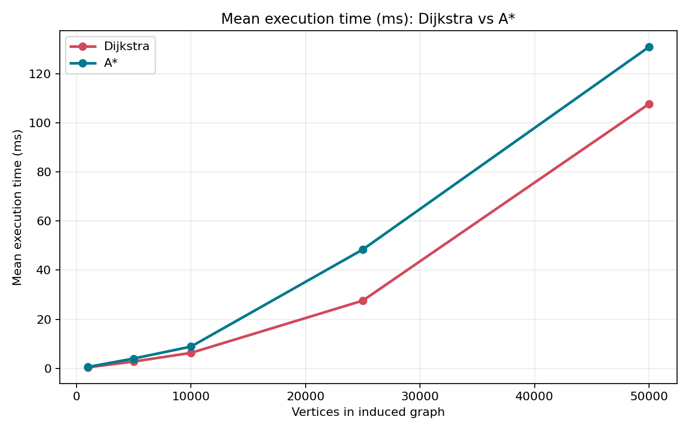

The horizontal axis is the number of vertices in the induced graph, and the vertical axis is mean search time in milliseconds. Both algorithms become slower as graph size and typical route span grow. Dijkstra increases from 0.525 ms at 1,000 vertices to 103.634 ms at 50,000 vertices. A* increases from 0.183 ms to 81.859 ms over the same range.

A* has the lower mean at every tested size. Its advantage is greatest on the 1,000- and 5,000-vertex graphs. At 25,000 vertices the lines almost meet: 29.842 ms for Dijkstra and 29.613 ms for A*. This does not mean that the algorithms performed the same amount of search work. A* explored 57.07% fewer vertices at that size, but coordinate projection and heuristic evaluation added computation per examined state. Wall-clock measurements are also sensitive to caching, scheduling, and the particular query sample, so operation counts should be considered alongside time.

#### Figure 2 - Mean vertices explored

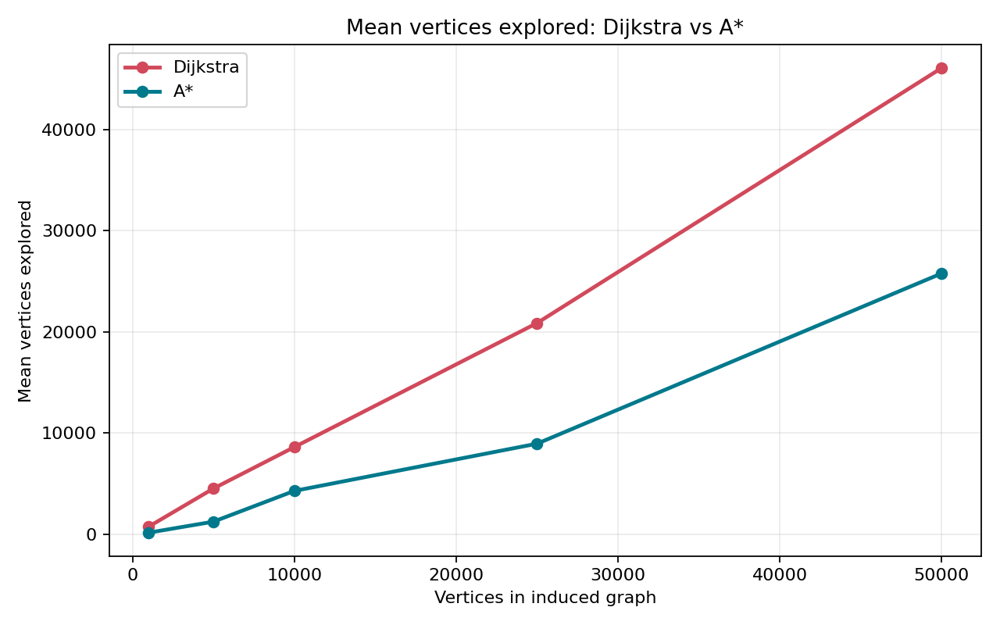

This graph counts vertices removed from the priority queue and actually expanded. Dijkstra expanded 764.4, 4,531.0, 8,626.8, 20,878.8, and 46,075.8 vertices on average as graph size increased. A* expanded only 170.2, 1,257.2, 4,297.2, 8,962.4, and 25,784.2.

The gap demonstrates the main algorithmic benefit of an informed heuristic. Dijkstra expands vertices according only to distance already travelled and therefore spreads outward from the source. A* also considers an admissible estimate of remaining distance and directs more of its work toward the destination. A* still expands more vertices on larger instances because routes become longer and the straight-line lower bound cannot represent every road turn, obstacle, or direction restriction.

#### Figure 3 - Mean edges examined

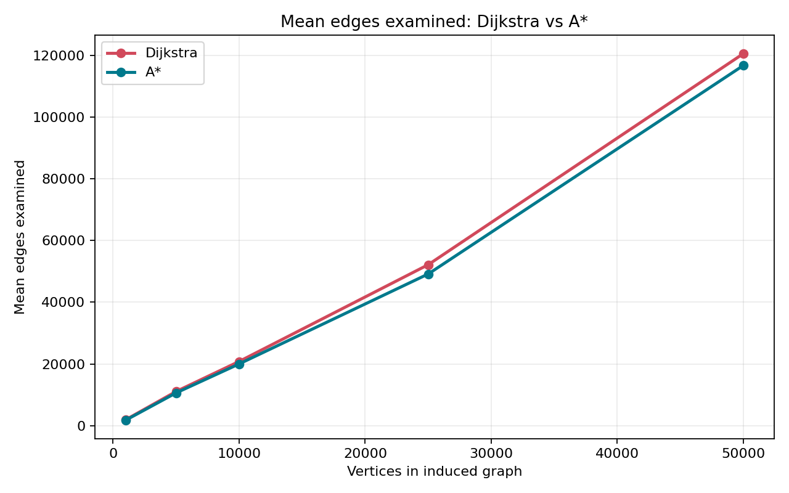

An edge is counted whenever an outgoing arc of an expanded vertex is inspected for relaxation. Dijkstra's mean rises from 1,924.8 examined edges at 1,000 vertices to 120,559.8 at 50,000. A* rises from 445.0 to 67,842.6. The shape closely follows the vertex-exploration graph because this is a sparse road network with a fairly stable average out-degree.

At 50,000 vertices, A* avoided examining 52,717.2 directed edges per query on average. Fewer examinations mean fewer additions, comparisons, possible distance updates, and heap insertions. The figure therefore explains why A* can improve runtime even though every A* state also requires a heuristic calculation.

#### Figure 4 - Percentage reduction in search work

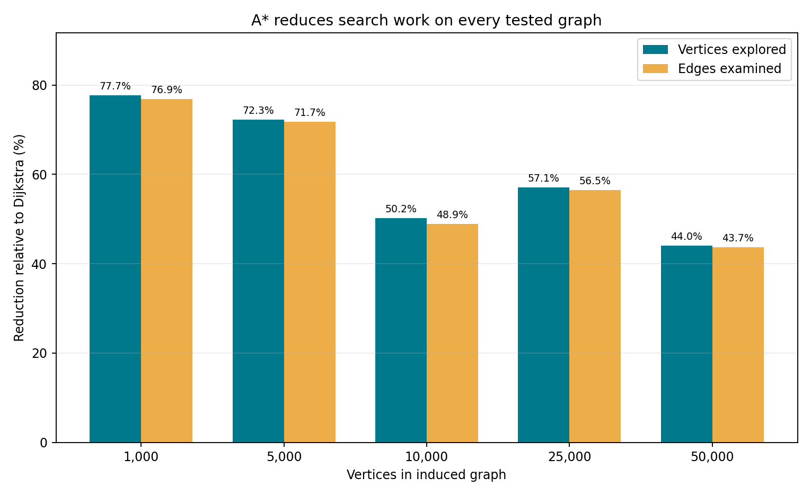

This figure normalizes the operation counts relative to Dijkstra. For a metric `M`, the plotted reduction is `100 * (1 - M_Astar/M_Dijkstra)`. A* reduced expanded vertices by 77.7%, 72.3%, 50.2%, 57.1%, and 44.0% across the five sizes. Edge reductions were nearly identical at 76.9%, 71.7%, 48.9%, 56.5%, and 43.7%.

The close pairing of the two bars at each size confirms that graph degree remains fairly stable: avoiding a vertex also avoids approximately the same proportion of its outgoing arcs. The percentage is not required to decrease monotonically with size because every size uses a different induced graph and five different endpoint pairs. Even the smallest measured reduction, about 44%, is substantial.

#### Figure 5 - Mean runtime speedup

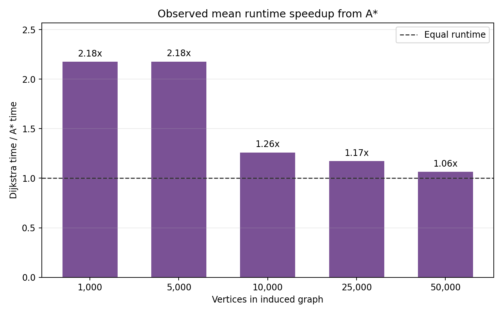

Speedup is calculated as `mean Dijkstra time / mean A* time`. A value above the dashed `1.0x` line means A* was faster. The measured ratios are 2.86x, 2.57x, 1.33x, 1.01x, and 1.27x for 1,000 through 50,000 vertices.

The graph separates computational savings from percentages: for example, `2.86x` means Dijkstra required about 2.86 times the mean runtime of A*. The near-`1.0x` value at 25,000 vertices shows that fewer expansions do not guarantee a proportional time improvement. Heuristic calculations, heap behavior, memory locality, and short benchmark duration can offset some saved relaxations. The result supports A* for this workload, while also showing why runtime must be measured rather than inferred only from asymptotic complexity.

#### Figure 6 - Runtime of every query

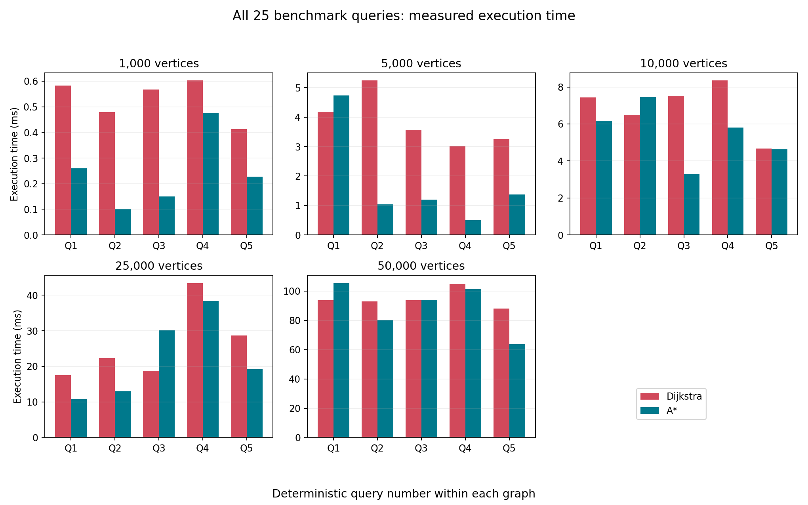

Each panel contains the five deterministic source-destination pairs for one graph size. The red bar is Dijkstra and the blue bar is A*. Each panel has its own vertical scale so that small runtimes remain visible; absolute bar heights must therefore be compared only within the same panel or by reading its axis.

The figure exposes variation hidden by the averages. A* is much faster for many queries, particularly on the smaller graphs, but it is slower for some individual cases, such as query 3 at 25,000 vertices. This is expected: heuristic effectiveness depends on route geometry and obstacles, while timing also includes fixed heuristic overhead and ordinary system noise. The recommendation is therefore based on all five queries per size and on operation counts, not on a single favorable run. Each displayed value is itself the median of five executions of that algorithm/query combination.

#### Figure 7 - Optimal-cost agreement

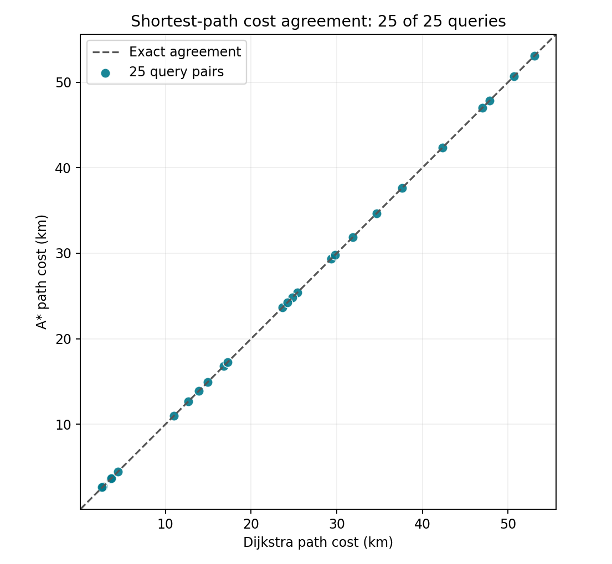

The horizontal axis gives Dijkstra's route cost in kilometers and the vertical axis gives A*'s cost for the identical query. Every one of the 25 markers lies on the dashed equality line `y=x`. Consequently, both implementations returned exactly the same native integer cost for every measured pair, ranging from short routes of only a few kilometers to routes longer than 50 km.

This is the central correctness check for A*. Lower runtime or fewer explored vertices would not be useful if optimality were lost. Agreement is expected because all weights are non-negative, Dijkstra is exact, and the calibrated A* heuristic is consistent. The pipeline checks equality before writing results and stops if any pair differs.

#### Figure 8 - Graph scaling and sparsity

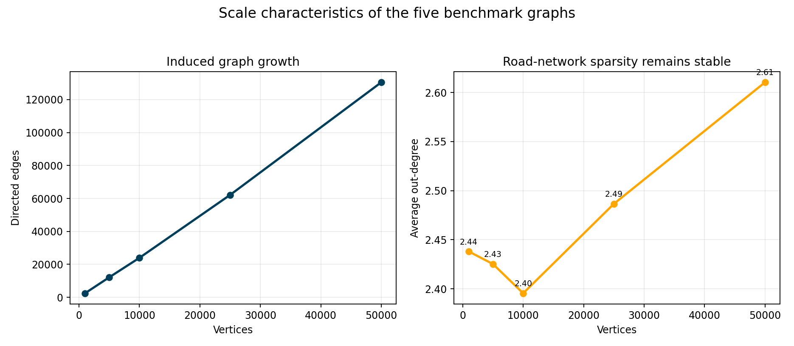

The left panel plots directed edges against vertices. Edge count grows from 2,438 at 1,000 vertices to 130,522 at 50,000 vertices and remains approximately linear. The right panel shows average out-degree values of 2.44, 2.43, 2.40, 2.49, and 2.61. These values remain within a narrow range even while vertex count increases fiftyfold.

This structure is characteristic of road networks: an intersection connects to only a few nearby roads rather than to every other intersection. Therefore `E` is approximately proportional to `V`, adjacency lists store the graph efficiently, and the practical heap-based complexity is close to `O(V log V)` for searches that explore a large fraction of a sample. The modest rise at 50,000 vertices reflects the particular BFS-induced region, not a transition to a dense graph.

### A* heuristic parameter study

The main comparison uses standard A* with the calibrated heuristic `h(v)`. A separate parameter experiment evaluates

```text
f(v) = g(v) + lambda*h(v)
```

for `lambda = 0, 0.25, 0.5, 0.75, 1, 1.25, 1.5, 2`. The same five graph sizes and same five deterministic query pairs per size are used, producing 200 configurations. Each configuration is timed five times and represented by its median run.

- `lambda=0` removes destination guidance and gives Dijkstra-like queue ordering.
- `0<lambda<1` uses a deliberately weakened heuristic. It remains consistent and optimal but provides less guidance.
- `lambda=1` is standard A* and uses the strongest tested heuristic with an exact optimality guarantee.
- `lambda>1` is weighted A*. It becomes greedier and may reduce work, but the inflated heuristic is no longer guaranteed to be admissible or consistent.

The percentages below are calculated independently at each graph size relative to that size's zero-heuristic result, then averaged across the five sizes. Lower work and runtime percentages are better.

| Lambda | Heuristic mode | Vertices (% of zero) | Edges (% of zero) | Runtime (% of zero) | Optimal queries | Maximum cost gap |
|---:|---|---:|---:|---:|---:|---:|
| 0.00 | Zero heuristic | 100.00% | 100.00% | 100.00% | 25/25 | 0.000% |
| 0.25 | Weakened admissible | 86.72% | 87.19% | 108.35% | 25/25 | 0.000% |
| 0.50 | Weakened admissible | 71.38% | 71.96% | 107.34% | 25/25 | 0.000% |
| 0.75 | Weakened admissible | 55.91% | 56.43% | 96.80% | 25/25 | 0.000% |
| 1.00 | Standard A* | 39.74% | 40.44% | 60.77% | 25/25 | 0.000% |
| 1.25 | Weighted A* | 22.29% | 23.03% | 36.39% | 13/25 | 3.689% |
| 1.50 | Weighted A* | 45.75% | 50.60% | 72.94% | 3/25 | 10.876% |
| 2.00 | Weighted A* | 29.53% | 30.75% | 45.52% | 2/25 | 18.024% |

#### Figure 9 - Search work versus heuristic strength

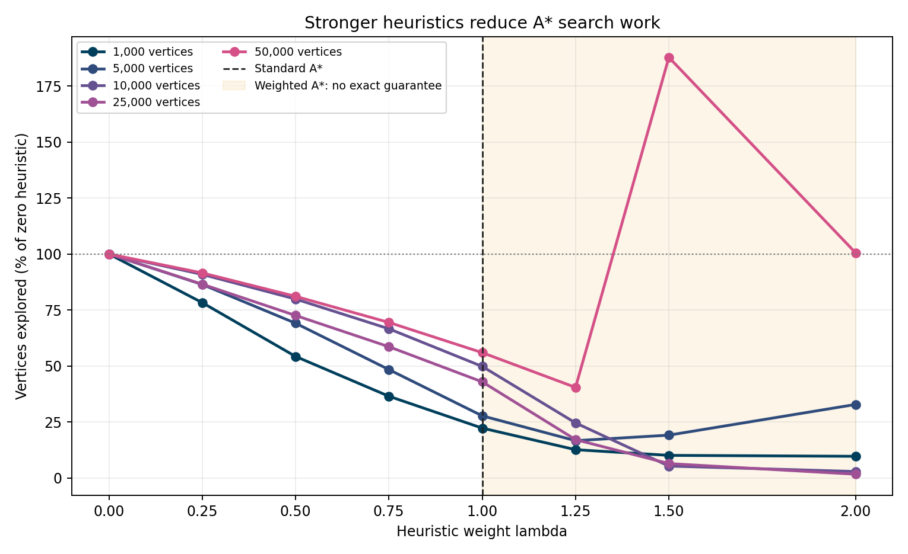

From `lambda=0` through `lambda=1`, explored vertices decrease monotonically at every graph size. This is the clearest demonstration that A* improves because of its heuristic rather than because of an unrelated implementation difference. Standard A* at `lambda=1` used only 39.74% as many vertices as the zero-heuristic configuration on average, a 60.26% reduction, while retaining all 25 optimal answers.

The shaded region is weighted A*. It can be extremely aggressive, but stronger is not always better. At 50,000 vertices, `lambda=1.5` caused many reopenings and explored 187.7% as many vertices as the zero heuristic, whereas `lambda=1.25` explored only 40.5%. An over-weighted heuristic can commit strongly to a misleading geographic direction, later discover better routes, and reopen states. The parameter must therefore be measured rather than assumed.

#### Figure 10 - Runtime versus heuristic strength

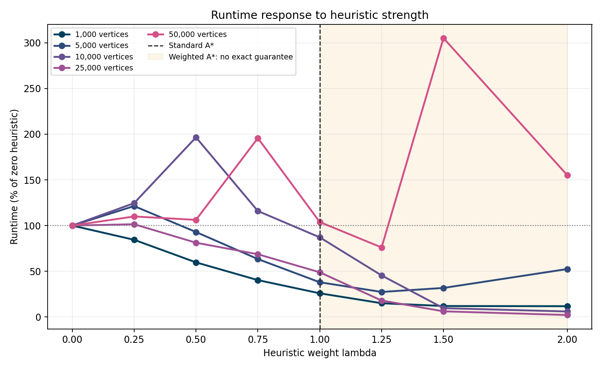

Runtime is noisier than operation counts. Weak settings such as `lambda=0.25` and `lambda=0.5` reduced search work without reducing mean normalized time because heuristic computation has a fixed cost and the saved work was too small. Standard A* averaged 60.77% of zero-heuristic runtime across sizes. It is the best tested setting that preserves the exact shortest-path guarantee.

Weighted `lambda=1.25` was faster on this aggregate measure, at 36.39% of zero-heuristic runtime, but it returned an optimal route for only 13 of 25 queries. The apparent speed gain is therefore not a like-for-like exact shortest-path result. The non-monotonic values at `1.5` and `2.0` also show that greedier search does not produce a monotonic speedup.

#### Figure 11 - Efficiency and optimality tradeoff

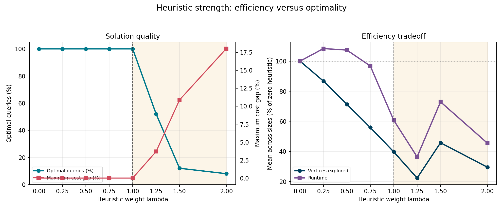

The left panel shows a sharp boundary at `lambda=1`. Every setting from zero through one remained optimal on 25 of 25 queries. Once the heuristic was inflated, optimality fell to 13/25 at `1.25`, 3/25 at `1.5`, and 2/25 at `2.0`; the worst observed cost gaps grew to 3.689%, 10.876%, and 18.024% respectively.

The right panel combines normalized work and runtime. The strongest defensible conclusion is that `lambda=1` is the preferred project configuration: it provides the largest tested heuristic under the proof of consistency, cuts mean search work substantially, improves mean runtime, and retains exact answers. Weighted A* is useful only when approximate routes are explicitly acceptable and the speed-quality tradeoff has been chosen deliberately.

## 7. Bonus: dynamic edge costs

The experiment models congestion with

```text
w'(u,v) = alpha * d(u,v) + beta * c(u,v)
alpha = 1, beta = 1
c(u,v) = 4 * d(u,v) for selected congested arcs, otherwise 0
```

Thus selected arcs cost `5d`, while unaffected arcs remain at `d`. The middle third of the original 50,000-vertex route is marked congested, then shortest path is recomputed from scratch.

| Bonus metric | Result |
|---|---:|
| Source -> destination | 2,069 -> 13,771 |
| Congested original-route arcs | 124 |
| Original native cost | 470,231 units |
| New native cost | 477,478 units |
| Original distance | 47,023.1 m |
| New distance | 47,747.8 m |
| Distance increase | 724.7 m (1.54%) |
| Original path length | 373 vertices |
| New path length | 388 vertices |
| Route changed | Yes |
| Shared directed path edges | 168 |

#### Figure 12 - Route before and after congestion

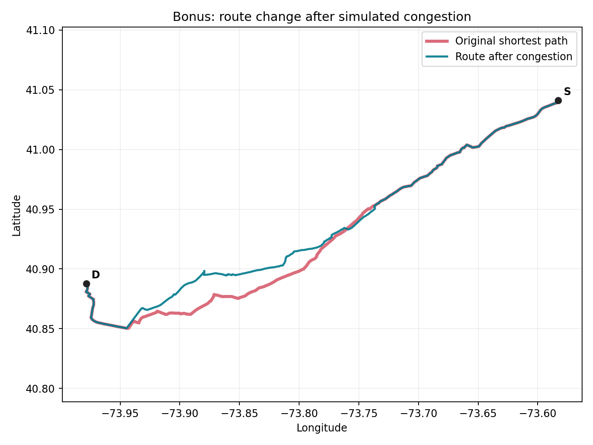

The red line is the original distance-optimal route and the blue line is the route after dynamic penalties are applied. `S` and `D` identify the same source and destination in both searches. Shared portions can visually overlap, while separated portions show where rerouting occurred.

The original route used 373 vertices and cost 470,231 native units, or 47,023.1 meters. Penalizing 124 arcs in its middle third caused the recomputed route to use 388 vertices and cost 477,478 native units, or 47,747.8 meters. The route therefore changed and accepted 724.7 meters of additional base distance, a 1.54% increase, to avoid edges whose dynamic cost had become five times their normal distance cost. The two paths retained 168 shared directed edges, which shows that the algorithm preserved useful unaffected sections and changed only the portion where an alternative was beneficial.

The result demonstrates the intended IoV interpretation: when congestion or another live condition changes edge costs, the best route may change even though the road topology and endpoints remain fixed. Recomputing from the current cost function produces the new optimum. The exact paths, modified arcs, and parameters are in [`dynamic_result.json`](results/bonus/dynamic_result.json).

## 8. Answers to the ten assignment questions (Part F)

### Q1. Why is this dataset suitable?

The `USA-road-d.NY` dataset is suitable because it is public, real, directed, weighted, geographic, and substantially larger than the maximum requested experiment. Its 264,346 vertices and 733,846 arcs allow samples of 1,000 through 50,000 vertices without duplicating synthetic structures. Vertices represent road-network locations, directed arcs represent permitted movements, and positive distance weights directly define the shortest-path objective.

It is especially appropriate for IoV routing because vehicles move through a sparse spatial network rather than a dense arbitrary graph. Coordinates allow a meaningful A* heuristic, while directionality captures cases where travel from `U` to `V` does not imply identical travel from `V` to `U`. New York was chosen instead of the full-USA graph because it preserves these properties while keeping download, memory, and experiment time practical for repeatable evaluation on an ordinary computer.

### Q2. How was it transformed into a weighted graph?

The parser first reads `p sp n m`, allocates `n+1` adjacency lists, and retains index 0 as unused so that array indexes match the official 1-based vertex IDs. Every `a U V W` line appends `Edge(to=V, weight=W)` to `adjacency[U]`. No reverse edge is invented; a reverse movement exists only when the file contains its own `a V U W2` record. Every `v ID X Y` line is stored as `(X/1,000,000, Y/1,000,000)`, producing decimal longitude and latitude.

Comments are ignored, but structural declarations are validated. Vertex ranges, non-negative weights, coordinate IDs, duplicate coordinates, and declared record counts are checked. Native integer weights are preserved for exact shortest-path comparisons; one native unit equals 0.1 meter, so presentation output also reports `cost_meters = native_cost * 0.1`. For each requested size, a connected BFS prefix is selected and converted into an induced subgraph containing only edges with both endpoints selected. Internal dense IDs improve array efficiency, while a reverse map restores official IDs in every reported path.

### Q3. Do Dijkstra and A* produce the same cost?

Yes. Dijkstra and A* produced exactly the same native integer shortest-path cost for all 25 source-destination pairs. The equality is visible in Figure 7, where every point lies on `y=x`, and is enforced programmatically before result files are written.

Dijkstra is optimal because all edge weights are non-negative and a vertex is settled only when it has the minimum tentative distance. A* uses the same relaxation rule but changes priority from `g(v)` to `g(v)+h(v)`. The calibrated heuristic is consistent, so a settled destination has an optimal cost. The two algorithms are not required to return an identical vertex sequence when several equal-cost routes exist; the required and verified property is identical minimum cost.

### Q4. Which explores fewer vertices, and why?

A* explored fewer vertices at every graph size. Its reductions relative to Dijkstra were 77.73%, 72.25%, 50.19%, 57.07%, and 44.04% from the smallest to the largest sample. Edge-examination reductions followed almost the same pattern.

Dijkstra uses only `g(v)`, the known distance from the source, and therefore expands a broad wavefront that includes many vertices in directions unrelated to the destination. A* adds `h(v)`, a lower bound on remaining cost, so vertices that are both cheap to reach and geographically promising receive priority. The heuristic never overestimates under the calibrated model, so this guidance reduces unnecessary work without sacrificing optimality. The amount saved varies by query because straight-line direction is more informative for some road layouts and endpoint pairs than for others.

### Q5. How does time vary with graph size?

Mean runtime generally increased with graph size and route span. Dijkstra rose from 0.525 ms at 1,000 vertices to 103.634 ms at 50,000 vertices, while A* rose from 0.183 ms to 81.859 ms. This increase is expected because larger searches can settle more vertices, scan more arcs, and perform more heap operations.

The growth is not a simple constant multiple of `V`. Runtime depends on the portion of the graph needed to reach the destination, average degree in that region, heap duplicates created by improved tentative distances, memory-cache behavior, and operating-system scheduling. The per-query graph shows meaningful variation even within a fixed size. A* was faster on the mean at every size, but its advantage narrowed at 25,000 vertices because heuristic computation offset much of the saved search work in those five queries.

### Q6. What is the effect of graph density?

Density determines how many outgoing edges must be examined whenever a vertex is expanded. If average degree rises, each expansion performs more relaxation tests and can create more priority-queue updates. With an adjacency list and binary heap, time is `O((V+E) log V)`, so increasing `E` directly raises computation even when `V` is unchanged.

This road network is sparse: the full graph has average out-degree 2.7761, and the experiment samples remain near 2.4-2.6. Consequently, `E` grows approximately linearly with `V`, as Figure 8 shows. An adjacency list stores only real arcs in `O(V+E)` space and allows the algorithm to scan only actual neighbors. An adjacency matrix would require `O(V^2)` memory and would waste work checking mostly absent edges, making it unsuitable at these sizes.

### Q7. What is Dijkstra's theoretical complexity?

The implementation uses an adjacency list and Python's binary min-heap. Each reachable vertex can be settled once, every outgoing edge from a settled vertex is scanned once, and heap insertion or removal costs `O(log V)` in the standard bound. The resulting time complexity is `O((V+E) log V)`. For a connected graph, `E` is at least proportional to `V`, so this is commonly simplified to `O(E log V)`.

The graph itself requires `O(V+E)` space. The distance, parent, and settled structures require `O(V)` auxiliary space. Lazy deletion can leave stale priority-queue records in the heap, so the heap may temporarily contain multiple records for a vertex; this does not change the standard `O(E log V)` time bound. For this sparse road network where `E` is approximately proportional to `V`, practical scaling is near `O(V log V)` when most of a sample is explored.

### Q8. Which A* heuristic is used; is it admissible/consistent?

The heuristic is straight-line distance to the destination in a fixed local equirectangular projection. Projection is needed because raw longitude and latitude are angular coordinates, not planar meters. The geometric distance is multiplied by a global safe scale computed as the minimum observed ratio `native_edge_weight/projected_edge_length` over usable arcs. This also converts meters into the graph's native 0.1-meter cost units.

For every arc `(u,v)`, calibration guarantees that the scaled geometric length from `u` to `v` is no larger than `w(u,v)`. The projected Euclidean metric obeys the triangle inequality, so `h(u) <= w(u,v) + h(v)`. This is the consistency condition. A consistent heuristic is also admissible, meaning it never overestimates the remaining optimal cost. Therefore A* keeps its optimality guarantee. If coordinates are missing or no safe positive scale is available, the implementation uses `h=0`, which reduces A* to Dijkstra and remains correct.

### Q9. What conversion difficulties arose?

Several format and modelling issues required explicit handling:

- The graph is directed, so reverse arcs cannot be assumed.
- Vertex IDs are 1-based and must remain traceable to the official files.
- Graph and coordinate data are separate and may be compressed or extracted.
- Coordinates are signed integers with six implied decimal places.
- Distance weights use decimeters, not meters, despite being stored as plain integers.
- Header counts, ID ranges, duplicate coordinates, and non-negative weights must be validated.
- An induced directed subgraph can contain unreachable source-destination pairs even when vertices were discovered from one BFS seed.
- The historical TIGER-derived data contains known road gaps and is not equivalent to a modern live navigation map.

The implementation addresses these issues through streaming plain/gzip input, strict validation, explicit unit metadata, direction-preserving adjacency lists, reachability-aware deterministic pair selection, internal-to-official ID mapping, and clear documentation of dataset limitations.

### Q10. Which algorithm is recommended for large-scale IoV/UAV planning?

For point-to-point routing on this geographic network, A* is recommended. It returned the same optimal cost as Dijkstra in all 25 queries, explored 44.04%-77.73% fewer vertices, examined 43.73%-76.88% fewer edges, and had a lower mean runtime at every tested size. It is particularly appropriate when a destination is known and reliable coordinates support a safe heuristic.

Dijkstra remains important as a reference implementation, a correctness oracle, and a fallback when coordinates are missing or when no admissible heuristic can be justified. It can also be preferable when distances from one source to many or all destinations are required, since A* is primarily goal-directed. For a production IoV or UAV system, the decision should additionally consider live cost updates, preprocessing options, repeated-query patterns, hardware, and the actual distribution of routes. Under the specific single-pair distance-routing conditions tested here, the evidence favors A*.


## 9. Testing and verification evidence

The test suite covers:

- known optimal cost and exact path;
- A*/Dijkstra agreement;
- disconnected destinations;
- source equals destination;
- compressed DIMACS graph and coordinate parsing.

Last local result:

```text
Ran 9 tests ... OK
```

The real-data pipeline adds 25 cross-algorithm cost assertions. The final generated artifacts are:

| Artifact | Purpose |
|---|---|
| [`graph_statistics.csv`](results/tables/graph_statistics.csv) | graph-size/edge/degree table |
| [`raw_results.csv`](results/tables/raw_results.csv) | all queries, metrics, and complete paths |
| [`summary_results.csv`](results/tables/summary_results.csv) | mean/median comparison table |
| [`metadata.json`](results/tables/metadata.json) | seed, sizes, query count, repetitions |
| [`heuristic_study_raw.csv`](results/tables/heuristic_study_raw.csv) | all 200 heuristic-weight/query configurations |
| [`heuristic_study_summary.csv`](results/tables/heuristic_study_summary.csv) | parameter results summarized by size and weight |
| [`heuristic_study_metadata.json`](results/tables/heuristic_study_metadata.json) | weights, seed, sizes, and timing repetitions |
| [`dynamic_result.json`](results/bonus/dynamic_result.json) | bonus parameters and both complete routes |
| [`runtime_comparison.png`](results/plots/runtime_comparison.png) | timing plot |
| [`vertices_explored.png`](results/plots/vertices_explored.png) | vertex-work plot |
| [`edges_examined.png`](results/plots/edges_examined.png) | edge-work plot |
| [`search_work_reduction.png`](results/plots/search_work_reduction.png) | A* vertex and edge reduction percentages |
| [`runtime_speedup.png`](results/plots/runtime_speedup.png) | Dijkstra-to-A* mean runtime ratio |
| [`per_query_runtime.png`](results/plots/per_query_runtime.png) | all 25 measured query comparisons |
| [`cost_agreement.png`](results/plots/cost_agreement.png) | shortest-path correctness agreement |
| [`graph_scaling.png`](results/plots/graph_scaling.png) | edge growth and average degree |
| [`heuristic_strength_vertices.png`](results/plots/heuristic_strength_vertices.png) | search work as heuristic weight changes |
| [`heuristic_strength_runtime.png`](results/plots/heuristic_strength_runtime.png) | normalized runtime as heuristic weight changes |
| [`heuristic_tradeoff.png`](results/plots/heuristic_tradeoff.png) | efficiency versus optimality tradeoff |
| [`dynamic_route_comparison.png`](results/plots/dynamic_route_comparison.png) | geographic bonus-route plot |

## 10. Useful CLI commands

After setting `PYTHONPATH=src` (or `$env:PYTHONPATH="src"` in PowerShell):

```bash
# Full graph statistics
python -m shortest_path.cli --graph data/raw/USA-road-d.NY.gr.gz --coordinates data/raw/USA-road-d.NY.co.gz stats

# One A* query with complete path and metrics
python -m shortest_path.cli --graph data/raw/USA-road-d.NY.gr.gz --coordinates data/raw/USA-road-d.NY.co.gz query 2069 13771 --algorithm astar

# The same query with weighted A*; values above 1 may be suboptimal
python -m shortest_path.cli --graph data/raw/USA-road-d.NY.gr.gz --coordinates data/raw/USA-road-d.NY.co.gz query 2069 13771 --algorithm astar --heuristic-weight 1.25

# Custom benchmark
python -m shortest_path.cli --graph data/raw/USA-road-d.NY.gr.gz --coordinates data/raw/USA-road-d.NY.co.gz benchmark --sizes 1000 5000 10000 --pairs 5 --repetitions 5

# Full heuristic-weight sweep
python -m shortest_path.cli --graph data/raw/USA-road-d.NY.gr.gz --coordinates data/raw/USA-road-d.NY.co.gz heuristic-study --weights 0 0.25 0.5 0.75 1 1.25 1.5 2

# Custom dynamic-cost experiment
python -m shortest_path.cli --graph data/raw/USA-road-d.NY.gr.gz --coordinates data/raw/USA-road-d.NY.co.gz dynamic 2069 13771
```

## 11. Final conclusion

The project demonstrates more than calling a shortest-path routine: it selects and verifies a public mobility dataset, parses a documented interchange format, models direction and weights explicitly, implements and instruments two algorithms, designs reproducible nested-scale experiments, validates optimality, exposes raw paths/results, visualizes scaling, and shows rerouting under dynamic costs.

The central empirical lesson is that unit-aware modelling matters. Once the geometric heuristic is calibrated to the dataset's native 0.1-meter weights, A* remains admissible, explores far less of the graph, and improves point-to-point runtime while producing exactly the same optimal cost as Dijkstra.

